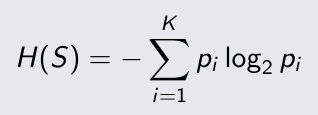
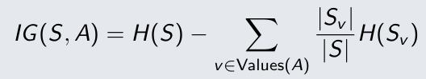
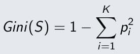

# PRE-RELEASE catch-up (W01-W04)

Written on: YYYY-MM-DD (the actual date; do not back-date). Length 500-900 words; plan about 2-3 hours for the whole catch-up.

## Foundations: baseline pipeline, leakage checklist, model taxonomy

## One train/validation curve diagnosis

## Decision Tree: own impurity/split routine, dissection of a full tree, one stopping/pruning comparison (include continuous and missing attributes)

## What the release-day baseline diagnostic showed

---

Written on: 2026-09-28
# [PRE-RELEASE] ML workflow, metrics, over/underfitting, bias–variance and decision tree.

## [W01]

### A. Concept capsule
Machine learning enables programs to improve at a task by learning from data and experience.

Different problems require different evaluation metrics:
- Classification: accuracy, precision, recall, and F1-score
- Regression: MSE and MAE

Training starts with a dataset that must be processed and split. Three common evaluation methods are:

1. **Hold-out:** split the data into training, validation, and test sets, often in proportions of 70%, 15%, and 15%.

2. **k-fold cross-validation:** divide the data into *k* folds, train on *k-1* folds, and validate on the remaining fold. Repeat until every fold has been used for validation, then average the results.

3. **Bootstrap evaluation:** repeatedly sample *n* observations with replacement. About 36.8% of observations are left out on average and can be used for testing.

#### Over/underfitting and bias–variance
- **Underfitting:** the model is too simple to represent the true function, causing high bias.
- **Overfitting:** the model is too complex and learns noise, causing high variance.

#### Classification metrics
For a binary Yes/No classifier, the confusion matrix is:
| | predicted positive | predited negative|
|:---|:---|:---|
|Actual positive| TP | FN |
|Actual negative| FP | TN |

If Yes is the positive label, TP and TN are correct predictions; FP predicts Yes incorrectly; FN misses an actual Yes.

Accuracy = (TP + TN) / (TP + TN + FP + FN)
Accuracy is the proportion of all correct predictions.

Precision = TP / (TP + FP)
Precision measures how reliable positive predictions are.

Recall = TP / (TP + FN)
Recall measures how many actual positives are found.

F1-score = 2* (Precision * Recall) / (Precision + Recall)

[Why some time use F1-score instead of accuracy?](../../AI_use.md#L03)

### B. One Derivation / Worked Example

[Why some time use F1-score instead of accuracy?](../../AI_use.md#L03)

### C. Reflection

I have gained a better understanding of the machine learning model training process and how to evaluate a model's performance. Additionally, I learned about the relationship between bias, variance, and model complexity, enabling me to adjust the model appropriately.

## [W02]

### A. Concept capsule

A decision tree is a flowchart that routes an input from the root to a leaf. It has three components:
1. **Internal node:** a feature test with at least two outcomes.
2. **Edge:** an outcome of a test.
3. **Leaf:** the predicted output.

Trees choose feature tests using impurity metrics.

#### Entropy.
Entropy measures the disorder of a dataset. High entropy indicates mixed classes and low entropy indicates a purer distribution.

the formular calculate entropy:

Information gain:

Information gain is the reduction in entropy after selecting an attribute as a feature test.

We choose the attribute with the highest information gain to make the resulting leaves as pure as possible.

#### GINI index
The Gini index formular:

The Gini index measures class impurity: 0 means perfectly pure, while the maximum depends on the number of classes (0.5 for two balanced classes). Splits aim to reduce impurity in each subtree.

### B. One Derivation / Worked Example

In the dataset [dataset Human Activity Recognition Using Smartphones](../../data/UCI%20HAR%20Dataset/UCI%20HAR%20Dataset/activity_labels.txt) there are 6 classes.

If all six classes are evenly distributed, the Gini index is:

G(S) = 1 - 6 * (1/6)^2 = 1 - 1/6 = 5/6 = 0.8(3)

Thus, the maximum for six classes is 0.8(3), not 0.5 as in the two-class case.

### C. Code-to-Theory Trace

I wrote a function to calculate the Gini index for a continuous attribute.

[gini function](../../src/02_decision_tree.py#3)

I first sort the data by the selected attribute and use the mean of each adjacent pair as a candidate boundary. The function has three parameters:

> def Gini_index(list_data, avr_adjacent, column):
> - list_data: the sorted dataset according to the chosen attribute.
> - avr_adjacent: the mean value of 2 adjacent value.
> - column: the index of attributing that is used.

The boundary splits the dataset into two parts. I calculate each part's Gini impurity, combine the weighted values, and return the result.

### D. Reflection

I better understand how to construct and evaluate a decision tree and when pruning may be necessary.

### E. Inquiry Trail

I still need to investigate the role of alpha in the cost-complexity equation.
