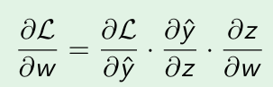

# W05 Perceptron, Delta Rule & Neural Networks (ANN)

How backward algorithm active in MLP?

## A. Concept capsule
When the dataset pass over the multi layer perceptron, we receives the output then use function loss too evaluate the performance of the model. Backward is the method that adjust the weight and bias value by passing the model's error from the output to the input, the node contributing the most to the error is adjusted at each step of the backward pass.

During training, the model first performs a forward pass to produce predictions. The loss measures prediction error. Backpropagation then applies the chain rule to calculate gradients, allowing each weight and bias to be updated and improve future model predictions more.

## B. One derivation or worked example

The goal of the backpropagation method is to determine the derivative of the loss function with respect to the weights; this aims to assess the extent to which the weights influence the loss function, thereby allowing for appropriate weight adjustments. However, the sequence of steps from w to L is w -> z (summation and bias) -> y (activation function) -> L (loss function). Therefore, establishing the relationship between W and L requires the following differentiation steps:



## C. Code-to-theory trace

[Gradient calculation for the weights](../../src/from_scratch/mlp.py#56)
in this code, gradiant weight in layer l equal: 

``` (1/m) * (A^(l-1)).T * dz^l
 m: number of element in the output matric
 l: current layer
 A: output of activation layer
 dz: deriation of L with z at this layer.
```

## D. One controlled experiment

The learning rate value are high will increase the speed of traing model. It is because the adjusting weight value become faster. But high lr value can make the model have less accuracy because it maybe miss out on optimal values ​​for the bias or weights.

## E. Failure / misconception

I get I misconception about the chain rule is talk about the net of the model, but chan rule is describe the relation ship of loss function to weight value of each layers.

## F. Written-exam capsule

The most important knownleadge of this chapter is backward algorithms, I need to get family with the process to calculate the new weight value. 

## G. Reflection

I have gained a better overview of how deep learning models work, something that previously left me feeling confused.
