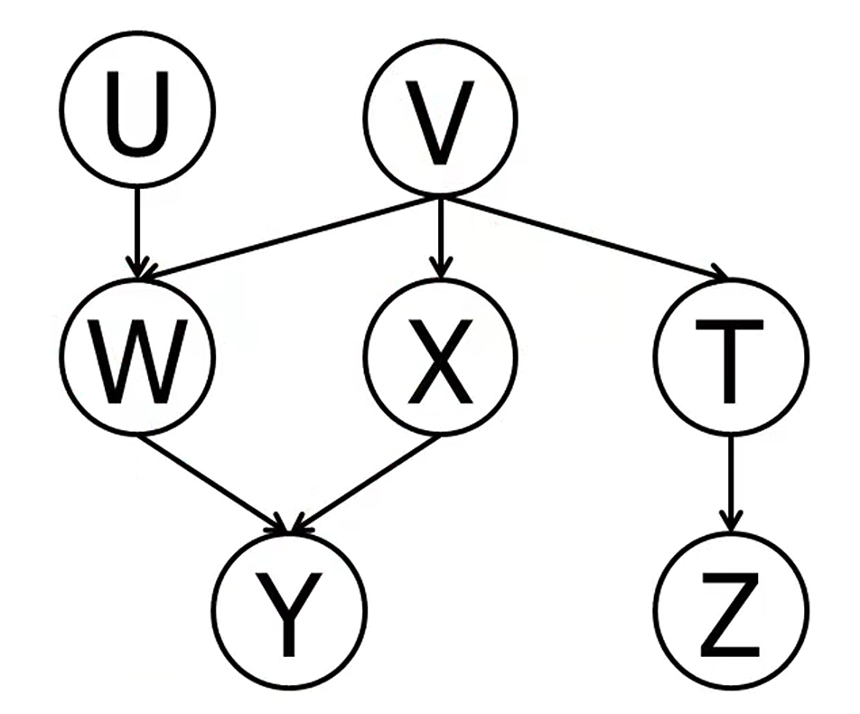

# W07 Genetic Algorithms & Bayesian Networks

## A. Concept capsule
In a Genetic Algorithm (GA), selected characteristics are represented by a sequence of numbers; this sequence can be binary, indicating whether a characteristic is selected or not—or non-binary to represent other values ​​of the characteristic. The fitness of the gene sequence is evaluated using a fitness function, where a higher value indicates a higher level of fitness.

In a Bayesian network, relationships can exist between features. The network is represented by a directed graph in which the value of a parent node influences the probability of a child node.
## B. One derivation or worked example

1. Y ⊥ Z: triple (Y,X,V) active; triple (X,V,T) active; tripple (V,T,Z) active -> path from Y to Z is active

2. Y ⊥ Z|V: triple (X,V,T) and (W,V,T) inactive by V and Y just only can reach Z by passing V -> path from Y to Z is blocked.

3. U ⊥ Z|Y: triple (U,V,W), because Y is observed, and the parent of Y is W lead to this tripple Active; tripple (W,V,T) active; tripple (V,T,Z) active -> path from U to Z is active.

4. T ⊥ Y|X: triples (T,V,X) and (T,V,W) are active; tripple (V,X,Y) blocked by X but (V,W,Y) is active -> path from T to Y is active.
## C. Code-to-theory trace

## D. One controlled experiment

## E. Failure / misconception
Initially, I confused the structural configuration of a node triple with the active-path condition used in the concept of d-separation. A chain or fork structure is typically active when the middle node is unobserved, whereas observing that node blocks the path. A collider structure operates in the opposite way: it blocks the path by default, and the path becomes active only when the collider node or one of its descendants is observed.

## F. Written-exam capsule

## G. Reflection
I have gained a fresh perspective on machine learning model structures. I appreciate the creativity involved in applying biological concepts or utilizing tree data structures for model training. While the material in this chapter was not overly difficult for me, it was entirely new and novel.

## H. Inquiry trail
